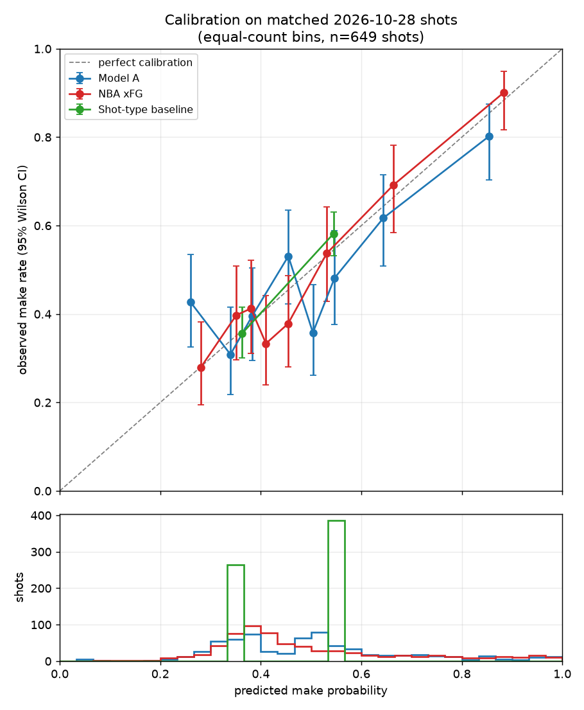

# Model A vs NBA xFG — 2026-10-28 (4 games)

Generated 2026-11-04T20:15:43+00:00. Ground truth = official make/miss. NBA xFG is a competing model, not the target.

## Read this first

* **Sample**: 649 matched field-goal attempts from 4 games on a single night. Differences of a few thousandths in log loss or Brier are well inside sampling noise at this size.
* **Uncertainty**: 95% intervals are shot-level paired bootstrap percentiles (2,000 resamples). They ignore within-game correlation and therefore understate uncertainty; with 4 games a game-level bootstrap is not meaningful.
* **Coverage bias**: Blueprint is missing official FGA, mostly misses and tip-ins (see the matching report). Both models are scored on the identical matched subset, which is not the full population of shots.
* **Inputs**: Model A sees ShotChartDetail-equivalent context and player priors from 2022-23/2023-24 only. NBA xFG uses per-shot tracking (defender distance, etc.). This is not a like-for-like information comparison.
* **Model A staleness**: 23.0% of compared shots come from players absent from the 2022-24 training data; Model A uses league-default priors for them (faithful to the trained model).

## Model A reproduction (prerequisite)

* Artifact `models/xpts_player_specific_model.pkl` sha256 `28f33625439cc174…` loaded with an allowlisting unpickler (globals: sklearn, numpy, xgboost, joblib array wrapper only). Trained with scikit-learn 1.4.2; run with {'scikit-learn': '1.9.1', 'xgboost': '3.4.1'}.
* Re-scoring the saved 2024-25 test features reproduces the saved predictions (max |Δ| = 2.98e-08) and the recorded metrics (max |Δ| = 0.0e+00). Status: **passed**.
* Player-prior tables were rebuilt from the 2022-23 + 2023-24 training seasons with the training code; merged onto the 2024-25 shots they reproduce the saved test feature matrix (status **passed**, max |Δ| = 0.0e+00 over 219,527 rows); see `models/model_a_assets/assets_meta.json`.

### Known property of the trained Model A (historical, not specific to this night)

Model A is over-confident at the extremes on its own 2024-25 test set, which explains the low calibration slope here. Individual 0.95+ predictions on three-pointers are produced by the original model with in-distribution inputs, not by the inference pipeline.

| shot_type | band | shots | share_of_shots | n_in_band | mean_pred_in_band | observed_fg_in_band |
| --- | --- | --- | --- | --- | --- | --- |
| 2PT | prediction > 0.8 | 127073 | 0.139 | 17665 | 0.903 | 0.822 |
| 2PT | prediction < 0.1 | 127073 | 0.024 | 3075 | 0.045 | 0.439 |
| 3PT | prediction > 0.8 | 92454 | 0.006 | 529 | 0.939 | 0.346 |
| 3PT | prediction < 0.1 | 92454 | 0.022 | 2051 | 0.046 | 0.244 |

## Primary metrics (identical matched shots)

| index | Model A | NBA xFG | Shot-type baseline |
| --- | --- | --- | --- |
| n | 649.0000 | 649.0000 | 649.0000 |
| observed_fg | 0.4900 | 0.4900 | 0.4900 |
| mean_pred | 0.4980 | 0.4935 | 0.4708 |
| mean_signed_error | 0.0080 | 0.0035 | -0.0192 |
| mean_abs_error | 0.4554 | 0.4261 | 0.4796 |
| log_loss | 0.6859 | 0.6064 | 0.6698 |
| brier | 0.2385 | 0.2116 | 0.2384 |
| roc_auc | 0.6326 | 0.6997 | 0.6090 |
| ece_quantile10 | 0.0721 | 0.0438 | 0.0247 |
| calibration_slope | 0.4954 | 1.0745 | 1.2419 |
| calibration_intercept | -0.0551 | -0.0067 | 0.1071 |
| mean_pred_on_makes | 0.5434 | 0.5687 | 0.4910 |
| mean_pred_on_misses | 0.4543 | 0.4212 | 0.4513 |

`mean_signed_error` = mean(prediction − outcome) (positive = over-predicts makes); `calibration_slope` < 1 indicates over-confident spread. The shot-type baseline is the 2022-24 league FG% for 2PT/3PT (not fit on these games).

| model | log_loss 95% CI | brier 95% CI | roc_auc 95% CI |
| --- | --- | --- | --- |
| Model A | 0.6508 – 0.7244 | 0.2259 – 0.2521 | 0.5874 – 0.6752 |
| NBA xFG | 0.5807 – 0.6337 | 0.2002 – 0.2236 | 0.6571 – 0.7395 |
| Shot-type baseline | 0.6558 – 0.6834 | 0.2316 – 0.2451 | 0.5732 – 0.6445 |

### Paired differences (first minus second; negative log loss / Brier difference favours the first model)

| quantity | metric | mean | ci_low | ci_high | share_below_zero |
| --- | --- | --- | --- | --- | --- |
| Model A - NBA xFG | log_loss | 0.0799 | 0.0445 | 0.1184 | 0.0000 |
| Model A - NBA xFG | brier | 0.0271 | 0.0145 | 0.0398 | 0.0000 |
| Model A - NBA xFG | roc_auc | -0.0676 | -0.1122 | -0.0247 | 0.9985 |
| Model A - Shot-type baseline | log_loss | 0.0166 | -0.0173 | 0.0545 | 0.1785 |
| Model A - Shot-type baseline | brier | 0.0003 | -0.0119 | 0.0132 | 0.4890 |
| Model A - Shot-type baseline | roc_auc | 0.0228 | -0.0210 | 0.0672 | 0.1625 |
| NBA xFG - Shot-type baseline | log_loss | -0.0633 | -0.0843 | -0.0399 | 1.0000 |
| NBA xFG - Shot-type baseline | brier | -0.0268 | -0.0358 | -0.0168 | 1.0000 |
| NBA xFG - Shot-type baseline | roc_auc | 0.0904 | 0.0555 | 0.1241 | 0.0000 |

## Model A on all official FGA (incl. shots Blueprint missed)

| model | n | observed_fg | mean_pred | log_loss | brier | roc_auc | ece_quantile10 |
| --- | --- | --- | --- | --- | --- | --- | --- |
| Model A | 681 | 0.4787 | 0.4970 | 0.6876 | 0.2393 | 0.6314 | 0.0732 |
| Shot-type baseline | 681 | 0.4787 | 0.4713 | 0.6732 | 0.2401 | 0.5960 | 0.0097 |

Model A on the official FGA that Blueprint does not contain:

| model | n | observed_fg | mean_pred | log_loss | brier |
| --- | --- | --- | --- | --- | --- |
| Model A | 32 | 0.2500 | 0.4778 | 0.7227 | 0.2557 |

## Secondary diagnostics

### By 2PT vs 3PT

| shot_type | n | observed_fg | Model A_mean_pred | Model A_log_loss | Model A_brier | NBA xFG_mean_pred | NBA xFG_log_loss | NBA xFG_brier |
| --- | --- | --- | --- | --- | --- | --- | --- | --- |
| 2PT | 385 | 0.582 | 0.560 | 0.666 | 0.230 | 0.579 | 0.574 | 0.198 |
| 3PT | 264 | 0.356 | 0.407 | 0.715 | 0.251 | 0.370 | 0.654 | 0.231 |

### By official shot distance

| dist_bin | n | observed_fg | Model A_mean_pred | Model A_log_loss | Model A_brier | NBA xFG_mean_pred | NBA xFG_log_loss | NBA xFG_brier |
| --- | --- | --- | --- | --- | --- | --- | --- | --- |
| 0-3 ft | 210 | 0.686 | 0.656 | 0.629 | 0.213 | 0.685 | 0.482 | 0.159 |
| 4-9 ft | 90 | 0.456 | 0.438 | 0.657 | 0.233 | 0.464 | 0.688 | 0.246 |
| 10-15 ft | 61 | 0.475 | 0.456 | 0.798 | 0.277 | 0.449 | 0.676 | 0.242 |
| 16-22 ft | 39 | 0.282 | 0.439 | 0.640 | 0.226 | 0.396 | 0.627 | 0.218 |
| 23+ ft | 249 | 0.373 | 0.406 | 0.725 | 0.254 | 0.369 | 0.662 | 0.235 |

### By shot zone

| SHOT_ZONE_BASIC | n | observed_fg | Model A_mean_pred | Model A_log_loss | Model A_brier | NBA xFG_mean_pred | NBA xFG_log_loss | NBA xFG_brier |
| --- | --- | --- | --- | --- | --- | --- | --- | --- |
| Above the Break 3 | 183 | 0.372 | 0.400 | 0.713 | 0.250 | 0.360 | 0.657 | 0.232 |
| In The Paint (Non-RA) | 108 | 0.463 | 0.437 | 0.685 | 0.241 | 0.470 | 0.690 | 0.247 |
| Left Corner 3 | 44 | 0.318 | 0.398 | 0.692 | 0.238 | 0.384 | 0.650 | 0.228 |
| Mid-Range | 67 | 0.448 | 0.458 | 0.751 | 0.266 | 0.421 | 0.675 | 0.242 |
| Restricted Area | 210 | 0.686 | 0.656 | 0.629 | 0.213 | 0.685 | 0.482 | 0.159 |
| Right Corner 3 | 37 | 0.324 | 0.454 | 0.754 | 0.270 | 0.397 | 0.645 | 0.227 |

### By closest-defender distance (Blueprint contest distance)

| contest_bin | n | observed_fg | Model A_mean_pred | Model A_log_loss | Model A_brier | NBA xFG_mean_pred | NBA xFG_log_loss | NBA xFG_brier |
| --- | --- | --- | --- | --- | --- | --- | --- | --- |
| 0-2 ft (very tight) | 214 | 0.421 | 0.489 | 0.709 | 0.248 | 0.426 | 0.636 | 0.222 |
| 2-4 ft (tight) | 214 | 0.486 | 0.473 | 0.734 | 0.258 | 0.475 | 0.647 | 0.228 |
| 4-6 ft (open) | 99 | 0.545 | 0.530 | 0.652 | 0.224 | 0.546 | 0.562 | 0.193 |
| 6+ ft (wide open) | 122 | 0.574 | 0.532 | 0.588 | 0.201 | 0.603 | 0.519 | 0.180 |

### By outcome (mean prediction on makes vs misses)

| outcome | n | observed_fg | Model A_mean_pred | Model A_log_loss | Model A_brier | NBA xFG_mean_pred | NBA xFG_log_loss | NBA xFG_brier |
| --- | --- | --- | --- | --- | --- | --- | --- | --- |
| made | 318 | 1.000 | 0.543 | 0.695 | 0.249 | 0.569 | 0.636 | 0.232 |
| missed | 331 | 0.000 | 0.454 | 0.677 | 0.228 | 0.421 | 0.578 | 0.192 |

### By Model A prior availability

| model_a_priors | n | observed_fg | Model A_mean_pred | Model A_log_loss | Model A_brier | NBA xFG_mean_pred | NBA xFG_log_loss | NBA xFG_brier |
| --- | --- | --- | --- | --- | --- | --- | --- | --- |
| league-default priors | 149 | 0.537 | 0.534 | 0.664 | 0.237 | 0.512 | 0.603 | 0.211 |
| player has 2022-24 priors | 500 | 0.476 | 0.487 | 0.692 | 0.239 | 0.488 | 0.607 | 0.212 |

### By game

| GAME_ID | n | observed_fg | Model A_mean_pred | Model A_log_loss | Model A_brier | NBA xFG_mean_pred | NBA xFG_log_loss | NBA xFG_brier |
| --- | --- | --- | --- | --- | --- | --- | --- | --- |
| 0022600132 | 181 | 0.530 | 0.495 | 0.653 | 0.230 | 0.497 | 0.613 | 0.214 |
| 0022600133 | 168 | 0.506 | 0.518 | 0.673 | 0.238 | 0.507 | 0.575 | 0.199 |
| 0022600134 | 142 | 0.451 | 0.476 | 0.680 | 0.237 | 0.468 | 0.606 | 0.211 |
| 0022600136 | 158 | 0.462 | 0.499 | 0.743 | 0.250 | 0.497 | 0.633 | 0.222 |

### By team

| team | n | observed_fg | Model A_mean_pred | Model A_log_loss | Model A_brier | NBA xFG_mean_pred | NBA xFG_log_loss | NBA xFG_brier |
| --- | --- | --- | --- | --- | --- | --- | --- | --- |
| ATL | 91 | 0.505 | 0.480 | 0.632 | 0.223 | 0.499 | 0.623 | 0.219 |
| CHA | 69 | 0.449 | 0.460 | 0.655 | 0.226 | 0.452 | 0.579 | 0.199 |
| CLE | 87 | 0.483 | 0.496 | 0.711 | 0.255 | 0.477 | 0.634 | 0.224 |
| DET | 73 | 0.452 | 0.492 | 0.704 | 0.248 | 0.484 | 0.631 | 0.222 |
| MIA | 90 | 0.556 | 0.510 | 0.674 | 0.238 | 0.495 | 0.604 | 0.209 |
| ORL | 76 | 0.421 | 0.487 | 0.784 | 0.259 | 0.499 | 0.615 | 0.213 |
| TOR | 82 | 0.500 | 0.510 | 0.706 | 0.241 | 0.496 | 0.649 | 0.230 |
| WAS | 81 | 0.531 | 0.543 | 0.632 | 0.219 | 0.540 | 0.511 | 0.173 |

### Players with at least 12 matched attempts

| player | n | observed_fg | Model A_mean_pred | Model A_log_loss | Model A_brier | NBA xFG_mean_pred | NBA xFG_log_loss | NBA xFG_brier |
| --- | --- | --- | --- | --- | --- | --- | --- | --- |
| AJ Dybantsa | 12 | 0.667 | 0.550 | 0.599 | 0.205 | 0.592 | 0.444 | 0.146 |
| Anthony Davis | 17 | 0.471 | 0.476 | 0.721 | 0.266 | 0.532 | 0.647 | 0.232 |
| Bam Adebayo | 14 | 0.571 | 0.455 | 0.661 | 0.235 | 0.472 | 0.682 | 0.240 |
| Brandon Miller | 25 | 0.480 | 0.478 | 0.684 | 0.227 | 0.484 | 0.540 | 0.182 |
| Cade Cunningham | 21 | 0.476 | 0.447 | 0.720 | 0.264 | 0.436 | 0.701 | 0.255 |
| Davion Mitchell | 12 | 0.417 | 0.555 | 0.702 | 0.247 | 0.472 | 0.522 | 0.175 |
| Desmond Bane | 12 | 0.250 | 0.493 | 0.953 | 0.317 | 0.438 | 0.665 | 0.236 |
| Donovan Mitchell | 13 | 0.462 | 0.520 | 0.706 | 0.254 | 0.389 | 0.744 | 0.273 |
| Duncan Robinson | 12 | 0.250 | 0.533 | 0.989 | 0.327 | 0.507 | 0.731 | 0.259 |
| Giannis Antetokounmpo | 16 | 0.688 | 0.693 | 0.482 | 0.165 | 0.612 | 0.479 | 0.150 |
| Immanuel Quickley | 14 | 0.357 | 0.465 | 0.906 | 0.293 | 0.448 | 0.751 | 0.277 |
| Jalen Johnson | 12 | 0.333 | 0.391 | 0.702 | 0.254 | 0.407 | 0.669 | 0.238 |
| James Harden | 17 | 0.235 | 0.446 | 0.617 | 0.213 | 0.427 | 0.557 | 0.185 |
| Kingston Flemings | 12 | 0.750 | 0.536 | 0.619 | 0.215 | 0.534 | 0.576 | 0.200 |
| Nickeil Alexander-Walker | 17 | 0.471 | 0.467 | 0.667 | 0.240 | 0.453 | 0.618 | 0.218 |
| Peyton Watson | 15 | 0.600 | 0.455 | 0.734 | 0.267 | 0.515 | 0.653 | 0.234 |
| RJ Barrett | 16 | 0.438 | 0.468 | 0.554 | 0.185 | 0.472 | 0.660 | 0.226 |
| Scottie Barnes | 16 | 0.625 | 0.509 | 0.659 | 0.239 | 0.547 | 0.531 | 0.178 |
| Trae Young | 12 | 0.250 | 0.464 | 0.817 | 0.262 | 0.332 | 0.531 | 0.174 |

## Model disagreement

* Correlation of Model A and NBA xFG: Pearson 0.601, Spearman 0.481.
* Mean |Model A − NBA| = 0.123; 46.8% of shots differ by ≥ 0.10 and 29.6% by ≥ 0.15.
* On the 192 shots differing by ≥ 0.15: observed FG 0.536, mean Model A 0.517, mean NBA 0.527, log loss Model A 0.822 vs NBA 0.586.

### Largest disagreements where Model A is higher

| shot_uid | PLAYER_NAME | team | ACTION_TYPE | SHOT_ZONE_BASIC | SHOT_DISTANCE | contest_distance_in | defender_name | model_a_player_has_priors | SHOT_MADE_FLAG | model_a_xfg | nba_xfg | diff |
| --- | --- | --- | --- | --- | --- | --- | --- | --- | --- | --- | --- | --- |
| 0022600136_0378 | RJ Barrett | TOR | Running Finger Roll Layup Shot | Restricted Area | 1 | 5.400 | Desmond Bane | True | 1 | 0.836 | 0.121 | 0.715 |
| 0022600133_0338 | Trae Young | WAS | Driving Floating Jump Shot | Above the Break 3 | 25 | 53.600 | Sam Merrill | True | 0 | 0.963 | 0.262 | 0.701 |
| 0022600136_0146 | Jamal Cain | ORL | Step Back Jump shot | Above the Break 3 | 25 | 28.400 | Jamison Battle | True | 0 | 0.970 | 0.362 | 0.608 |
| 0022600136_0756 | Colin Castleton | ORL | Driving Floating Jump Shot | Mid-Range | 11 | 18.300 | Allen Graves | True | 0 | 0.975 | 0.402 | 0.573 |
| 0022600132_0274 | Davion Mitchell | MIA | Driving Reverse Layup Shot | Restricted Area | 0 | 13.100 | Dyson Daniels | True | 0 | 0.844 | 0.274 | 0.570 |
| 0022600136_0111 | Trayce Jackson-Davis | TOR | Putback Layup Shot | Restricted Area | 1 | 18.400 | Nikola Vučević | True | 0 | 0.692 | 0.213 | 0.479 |
| 0022600136_0638 | Immanuel Quickley | TOR | Cutting Finger Roll Layup Shot | Restricted Area | 2 | 10.100 | Desmond Bane | True | 0 | 0.980 | 0.525 | 0.455 |
| 0022600134_0608 | Ausar Thompson | DET | Turnaround Jump Shot | Mid-Range | 10 | 8.300 | Moussa Diabaté | True | 0 | 0.500 | 0.076 | 0.424 |
| 0022600132_0189 | Aaron Wiggins | ATL | Driving Finger Roll Layup Shot | Restricted Area | 1 | 18.400 | Pelle Larsson | True | 1 | 0.796 | 0.390 | 0.406 |
| 0022600132_0361 | Onyeka Okongwu | ATL | Driving Layup Shot | Restricted Area | 2 | 7.400 | Klay Thompson | True | 0 | 0.541 | 0.154 | 0.387 |
| 0022600136_0411 | Desmond Bane | ORL | Reverse Layup Shot | Restricted Area | 2 | 18.000 | Ja'Kobe Walter | True | 0 | 0.969 | 0.608 | 0.361 |
| 0022600136_0046 | Franz Wagner | ORL | Driving Floating Bank Jump Shot | In The Paint (Non-RA) | 7 | 15.500 | Ja'Kobe Walter | True | 1 | 0.560 | 0.201 | 0.359 |

### Largest disagreements where NBA xFG is higher

| shot_uid | PLAYER_NAME | team | ACTION_TYPE | SHOT_ZONE_BASIC | SHOT_DISTANCE | contest_distance_in | defender_name | model_a_player_has_priors | SHOT_MADE_FLAG | model_a_xfg | nba_xfg | diff |
| --- | --- | --- | --- | --- | --- | --- | --- | --- | --- | --- | --- | --- |
| 0022600132_0424 | Dyson Daniels | ATL | Tip Layup Shot | In The Paint (Non-RA) | 5 | 38.000 | Klay Thompson | True | 0 | 0.184 | 0.814 | -0.630 |
| 0022600136_0548 | Anthony Black | ORL | Jump Bank Shot | Restricted Area | 1 | 32.300 | Trayce Jackson-Davis | True | 1 | 0.042 | 0.636 | -0.594 |
| 0022600136_0148 | Trayce Jackson-Davis | TOR | Floating Jump shot | In The Paint (Non-RA) | 10 | 76.800 | Nikola Vučević | True | 1 | 0.035 | 0.577 | -0.542 |
| 0022600133_0291 | Peyton Watson | CLE | Tip Layup Shot | Restricted Area | 0 | 110.300 | Anthony Davis | True | 1 | 0.389 | 0.910 | -0.521 |
| 0022600133_0056 | Kyshawn George | WAS | Alley Oop Layup shot | Restricted Area | 2 | 139.000 | Peyton Watson | False | 1 | 0.489 | 0.984 | -0.495 |
| 0022600132_0183 | Bobby Portis Jr. | MIA | Driving Layup Shot | Restricted Area | 1 | 81.100 | Aaron Wiggins | True | 1 | 0.406 | 0.898 | -0.492 |
| 0022600134_0028 | John Collins | DET | Turnaround Jump Shot | Restricted Area | 3 | 24.500 | Brandon Miller | True | 0 | 0.038 | 0.528 | -0.490 |
| 0022600136_0021 | Anthony Black | ORL | Driving Layup Shot | Restricted Area | 1 | 46.100 | Jakob Poeltl | True | 1 | 0.410 | 0.846 | -0.436 |
| 0022600133_0609 | Peyton Watson | CLE | Putback Layup Shot | Restricted Area | 2 | 15.000 | Kyshawn George | True | 1 | 0.226 | 0.649 | -0.423 |
| 0022600132_0494 | Jock Landale | ATL | Driving Finger Roll Layup Shot | Restricted Area | 1 | 81.200 | Bobby Portis Jr. | True | 1 | 0.534 | 0.946 | -0.412 |
| 0022600132_0286 | Nikola Jović | MIA | Putback Layup Shot | Restricted Area | 0 | 47.700 | Onyeka Okongwu | True | 1 | 0.291 | 0.690 | -0.399 |
| 0022600132_0651 | Dyson Daniels | ATL | Tip Layup Shot | Restricted Area | 0 | 31.900 | Andrew Wiggins | True | 1 | 0.540 | 0.922 | -0.382 |

Individual shots are illustrations only; a single low-probability make says nothing about model quality.

### Extreme Model A predictions on these shots

| shot_type | band | shots | share_of_shots | n_in_band | mean_pred_in_band | observed_fg_in_band |
| --- | --- | --- | --- | --- | --- | --- |
| 2PT | prediction > 0.8 | 385 | 0.125 | 48 | 0.911 | 0.833 |
| 2PT | prediction < 0.1 | 385 | 0.008 | 3 | 0.038 | 0.667 |
| 3PT | prediction > 0.8 | 264 | 0.008 | 2 | 0.966 | 0.000 |
| 3PT | prediction < 0.1 | 264 | 0.019 | 5 | 0.053 | 0.600 |

## Historical reference (not comparable)

Model A's recorded test metrics on 2024-25 ShotChartDetail shots (n = 219,527): ROC AUC 0.6337, log loss 0.6786, Brier 0.2370. Different season, population and sample size; these are not a head-to-head benchmark against NBA xFG. Note also that the defender-profile priors used at training time include 2024-25 data, so those historical test metrics carry mild leakage.
