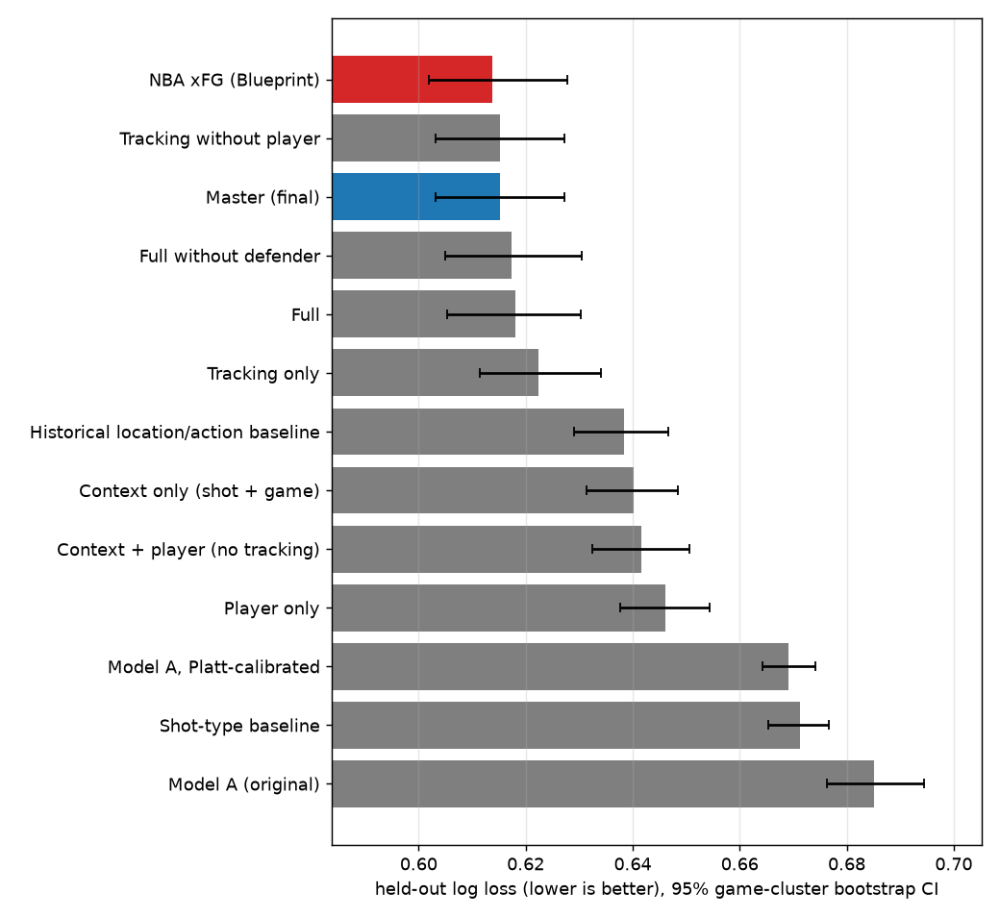
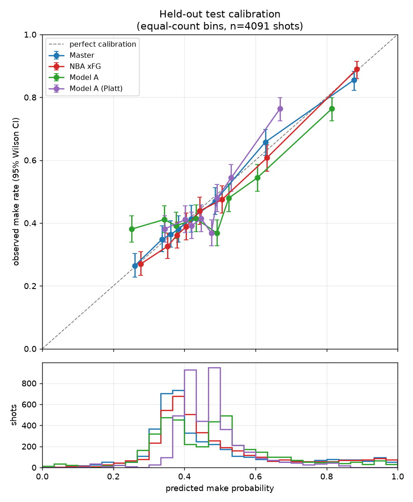
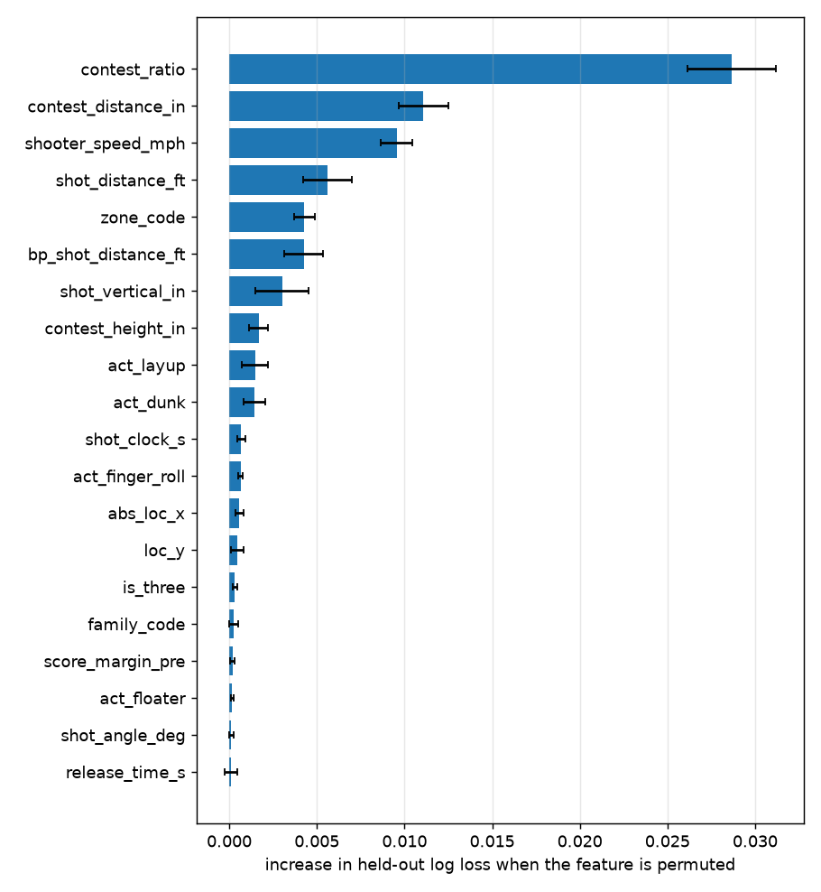
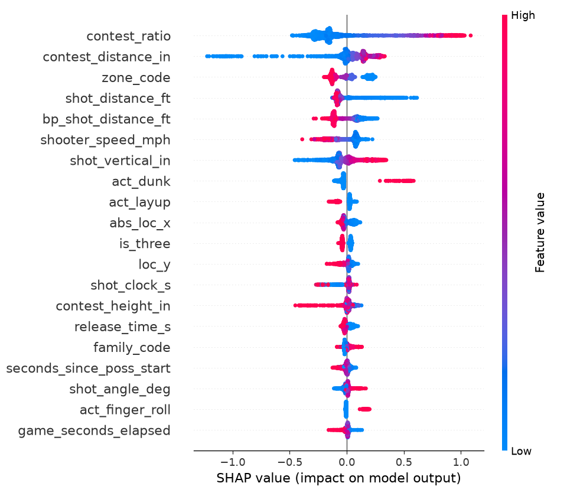
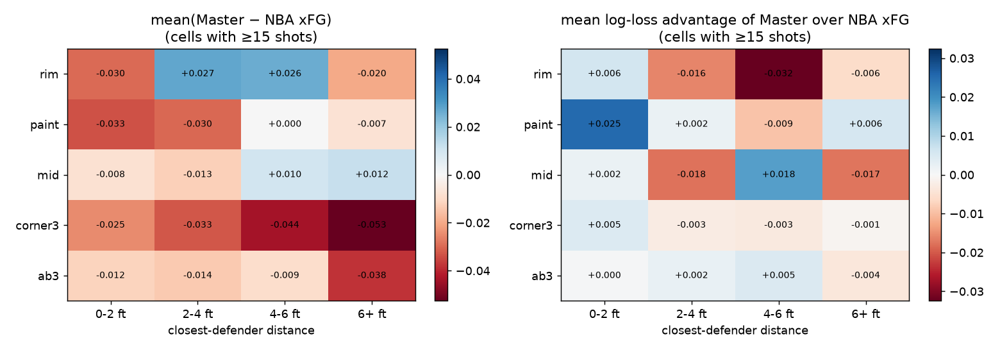
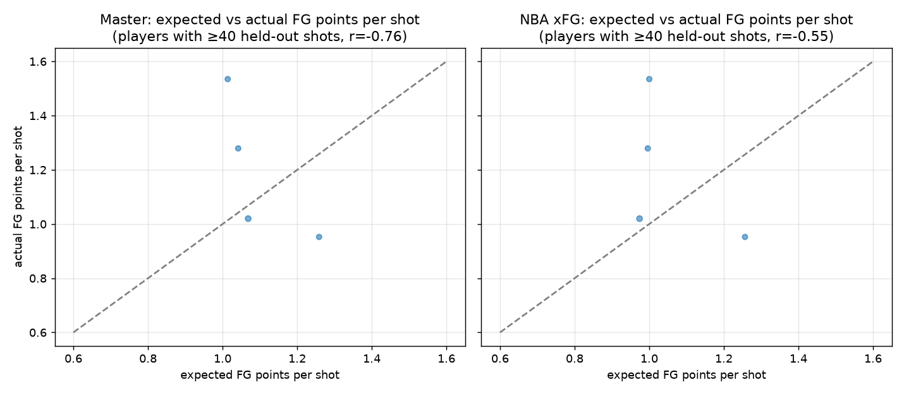
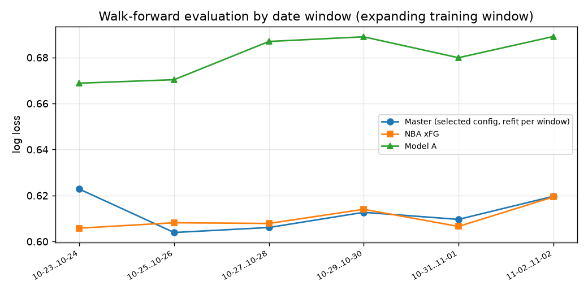
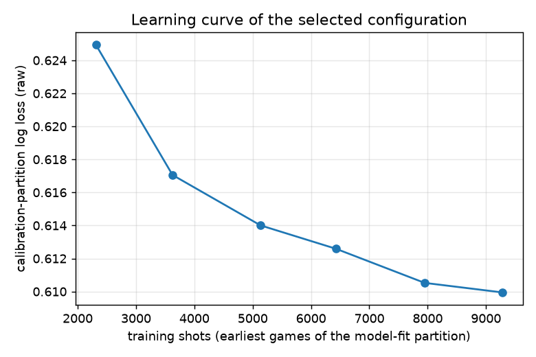

# Master xFG model report

Run `20261104T210006`, model `master_master_v1_20261104T210006`, dataset `master_v1`. Generated by `python -m pipeline evaluate-master`; all numbers below are computed, none are hand-entered.

## 1. Executive summary

* Data: 107 verified 2026-27 regular-season games through 2026-11-02 (18,852 official field-goal attempts, 17,389 matched one-to-one to Blueprint tracking records).
* Protocol: chronological split on whole game dates. Model-fit 2026-10-20..2026-10-27 (9,279 shots), calibration 2026-10-28..2026-10-30 (4,019), untouched test 2026-10-31..2026-11-02 (4,091 shots, 26 games).
* Selected: **catboost** on feature set **tracking_without_player**, calibration `none` (all chosen on the calibration partition).
* Test log loss: Master 0.6152, NBA xFG 0.6138, Model A 0.6852, calibrated Model A 0.6691.
* vs NBA xFG: The difference between Master and NBA xFG is not statistically distinguishable from zero (+0.0012, 95% CI [-0.0063, +0.0073]).
* vs Model A: Master has lower log loss than Model A (difference -0.0700, 95% CI [-0.0825, -0.0582]). vs calibrated Model A: Master has lower log loss than calibrated Model A (difference -0.0539, 95% CI [-0.0647, -0.0428]).
* Status: **exploratory**. Detecting a paired log-loss difference of 0.0050 vs NBA xFG with 80% power needs ≈15,604 test shots given the observed variance and game clustering (design effect 1.42); the test set has 4,091.
* Tracking is the main source of skill: Context + tracking has lower log loss than context only (difference -0.0249, 95% CI [-0.0309, -0.0185]).
* Player priors (career and in-season shrunk FG% / shot-making) add no measurable value on top of context + tracking this early in the season: The difference between the full model and context + tracking is not statistically distinguishable from zero (+0.0030, 95% CI [-0.0006, +0.0067]). Without tracking: The difference between context + player and context only is not statistically distinguishable from zero (+0.0015, 95% CI [-0.0011, +0.0042]).

## 2. Data and coverage

Season ingestion (`docs/DATA_MATCHING.md`, `data/reports/season/COVERAGE_REPORT.md`): 107 games seen, 107 verified, 17,389 of 18,852 official FGA in verified games matched to a Blueprint record (92.2%). Official shots without a Blueprint record are absent from Blueprint's published data (the page contains no record for them); no xFG is invented for them, and they are excluded from training/evaluation but still contribute (as earlier-game outcomes) to in-season player priors.

## 3. Feature engineering

Feature groups (`configs/features.yaml`); every feature is available before the shot is released:

* **shot_context** (25): `is_three`, `shot_distance_ft`, `loc_x`, `loc_y`, `abs_loc_x`, `shot_angle_deg`, `is_corner3`, `is_backcourt`, `zone_code`, `family_code`, `act_driving`, `act_running`, `act_cutting`, `act_pullup`, `act_stepback`, `act_fadeaway`, `act_turnaround`, `act_floater`, `act_hook`, `act_layup`, `act_dunk`, `act_tip_putback`, `act_alley_oop`, `act_reverse`, `act_finger_roll`
* **game_context** (12): `period`, `period_seconds_remaining`, `game_seconds_elapsed`, `is_overtime`, `end_of_period_heave_window`, `is_home`, `score_margin_pre`, `poss_code`, `seconds_since_poss_start`, `second_chance`, `after_timeout`, `shooter_fga_before_game`
* **tracking** (11): `shot_clock_s`, `shot_clock_missing`, `contest_distance_in`, `contest_height_in`, `shot_vertical_in`, `shooter_speed_mph`, `release_time_s`, `release_time_zero`, `release_time_capped`, `bp_shot_distance_ft`, `contest_ratio`
* **player** (16): `pl_fg_all_post`, `pl_fg_type_post`, `pl_fg_zone_post`, `pl_fg_family_post`, `pl_smoe_all_post`, `pl_smoe_type_post`, `pl_smoe_zone_post`, `pl_smoe_family_post`, `pl_log_att_all`, `pl_log_att_zone`, `pl_log_att_family`, `pl_three_rate`, `pl_rim_rate`, `pl_smoe_season_sd`, `pl_has_history`, `pl_season_att`
* **player_tracking** (2): `pl_fg_def_range_post`, `pl_fg_def_range_vs_league`
* **defender** (2): `def_smoe_allowed_post`, `def_contests_season`

Leakage controls: pre-shot score from the previous play-by-play action (the shot row's score is post-shot); in-season player/defender priors from games dated strictly before the shot's game; pre-season priors from 2021-22..2025-26; the shot-difficulty baseline used for shot-making-over-expected was fitted on 2022-23..2024-25 only; the outcome-biased `Bank` token is removed from ACTION_TYPE (historical bank variants shoot 50-59% vs 38-40% for the same action without it). Forbidden as inputs: `made`, `SHOT_MADE_FLAG`, `EVENT_TYPE`, `nba_xfg`, `nba_xpts_fg`, `bp_xpts_fg_only`, `home_score_after`, `away_score_after`, `pbp_scoreHome`, `pbp_scoreAway`, `pbp_description`, `pbp_shotResult`, `featured`, `model_a_xfg`, `actual_fg_points`, `shooter_fgm_before_game`.

## 4. Architecture selection

Each family was tuned with Optuna (TPE, seeded) on rolling-origin CV inside the model-fit partition, refit on the full model-fit partition, and compared on the calibration partition after cross-fitted calibration selection.

| family | rolling_cv_log_loss | trials | n_estimators | calibration | calibration_partition_log_loss |
|---|---|---|---|---|---|
| logistic | 0.6204 | 25 |  | platt | 0.6155 |
| xgboost | 0.6083 | 40 | 286 | none | 0.6121 |
| lightgbm | 0.6101 | 40 | 171 | none | 0.6132 |
| catboost | 0.6113 | 25 | 521 | none | 0.6115 |

Test-partition log loss of the same candidates (reported for transparency, not used for selection):

| model | log_loss | brier | auc | cal_slope |
|---|---|---|---|---|
| logistic (full features) | 0.6283 | 0.2194 | 0.6805 | 0.8926 |
| xgboost (full features) | 0.6178 | 0.2155 | 0.6899 | 0.9657 |
| lightgbm (full features) | 0.6166 | 0.2150 | 0.6934 | 0.9649 |
| catboost (full features) | 0.6181 | 0.2156 | 0.6920 | 0.9825 |

## 5. Results on the untouched test set

| Model | log_loss | brier | auc | cal_slope | cal_intercept | ece | shots |
|---|---|---|---|---|---|---|---|
| NBA xFG (Blueprint) | 0.6138 | 0.2138 | 0.6970 | 0.9921 | -0.0730 | 0.0186 | 4,091 |
| Model A (original) | 0.6852 | 0.2409 | 0.6141 | 0.5021 | -0.0946 | 0.0650 | 4,091 |
| Model A, Platt-calibrated | 0.6691 | 0.2378 | 0.6141 | 1.0396 | -0.0113 | 0.0495 | 4,091 |
| Tracking only | 0.6225 | 0.2174 | 0.6851 | 0.9262 | -0.0069 | 0.0250 | 4,091 |
| Player only | 0.6461 | 0.2276 | 0.6508 | 1.0556 | 0.0036 | 0.0250 | 4,091 |
| Master (final) | 0.6152 | 0.2142 | 0.6944 | 0.9650 | -0.0075 | 0.0132 | 4,091 |

Calibration = logistic recalibration slope/intercept (ideal 1 / 0) and 10-bin equal-count ECE. All rows are the identical 4,091 held-out shots.

All models and benchmarks:

| model | log_loss | brier | auc | cal_slope | ece | mean_pred | observed |
|---|---|---|---|---|---|---|---|
| NBA xFG (Blueprint) | 0.6138 | 0.2138 | 0.6970 | 0.9921 | 0.0186 | 0.4845 | 0.4691 |
| Model A (original) | 0.6852 | 0.2409 | 0.6141 | 0.5021 | 0.0650 | 0.4801 | 0.4691 |
| Model A, Platt-calibrated | 0.6691 | 0.2378 | 0.6141 | 1.0396 | 0.0495 | 0.4729 | 0.4691 |
| Shot-type baseline | 0.6713 | 0.2392 | 0.5999 | 0.8964 | 0.0111 | 0.4693 | 0.4691 |
| Historical location/action baseline | 0.6384 | 0.2243 | 0.6594 | 1.0357 | 0.0147 | 0.4665 | 0.4691 |
| Context only (shot + game) | 0.6402 | 0.2250 | 0.6554 | 0.9935 | 0.0142 | 0.4681 | 0.4691 |
| Tracking only | 0.6225 | 0.2174 | 0.6851 | 0.9262 | 0.0250 | 0.4673 | 0.4691 |
| Player only | 0.6461 | 0.2276 | 0.6508 | 1.0556 | 0.0250 | 0.4702 | 0.4691 |
| Tracking without player | 0.6152 | 0.2142 | 0.6944 | 0.9650 | 0.0132 | 0.4690 | 0.4691 |
| Context + player (no tracking) | 0.6416 | 0.2257 | 0.6539 | 0.9680 | 0.0174 | 0.4671 | 0.4691 |
| Full without defender | 0.6174 | 0.2155 | 0.6904 | 0.9787 | 0.0235 | 0.4721 | 0.4691 |
| Full | 0.6181 | 0.2156 | 0.6920 | 0.9825 | 0.0247 | 0.4541 | 0.4691 |
| Master (final) | 0.6152 | 0.2142 | 0.6944 | 0.9650 | 0.0132 | 0.4690 | 0.4691 |

Paired game-cluster bootstrap (2,000 resamples of test games) of log-loss differences (negative = first model better):

| quantity | mean | ci_low | ci_high | share_below_zero |
|---|---|---|---|---|
| Master (final) - NBA xFG (Blueprint) | 0.0012 | -0.0063 | 0.0073 | 0.3560 |
| Master (final) - Model A (original) | -0.0700 | -0.0825 | -0.0582 | 1.0000 |
| Master (final) - Model A, Platt-calibrated | -0.0539 | -0.0647 | -0.0428 | 1.0000 |
| Master (final) - Shot-type baseline | -0.0561 | -0.0662 | -0.0454 | 1.0000 |
| Full - Tracking without player | 0.0030 | -0.0006 | 0.0067 | 0.0515 |
| Tracking without player - Context only (shot + game) | -0.0249 | -0.0309 | -0.0185 | 1.0000 |
| Context + player (no tracking) - Context only (shot + game) | 0.0015 | -0.0011 | 0.0042 | 0.1460 |
| Full - Full without defender | 0.0007 | -0.0022 | 0.0039 | 0.3355 |

Calibration-partition results (the data used for selection):

| model | log_loss | brier | auc | cal_slope | shots |
|---|---|---|---|---|---|
| NBA xFG (Blueprint) | 0.6129 | 0.2137 | 0.6958 | 1.0067 | 4,019 |
| Model A (original) | 0.6876 | 0.2409 | 0.6174 | 0.4829 | 4,019 |
| Model A, Platt-calibrated | 0.6687 | 0.2375 | 0.6174 | 1.0000 | 4,019 |
| Shot-type baseline | 0.6715 | 0.2393 | 0.5995 | 0.9019 | 4,019 |
| Historical location/action baseline | 0.6368 | 0.2238 | 0.6640 | 1.0400 | 4,019 |
| Context only (shot + game) | 0.6386 | 0.2248 | 0.6580 | 1.0141 | 4,019 |
| Tracking only | 0.6175 | 0.2158 | 0.6889 | 0.9643 | 4,019 |
| Player only | 0.6468 | 0.2281 | 0.6524 | 1.0611 | 4,019 |
| Tracking without player | 0.6099 | 0.2128 | 0.6954 | 1.0023 | 4,019 |
| Context + player (no tracking) | 0.6401 | 0.2253 | 0.6611 | 0.9870 | 4,019 |
| Full without defender | 0.6129 | 0.2138 | 0.6978 | 0.9985 | 4,019 |
| Full | 0.6115 | 0.2132 | 0.6999 | 1.0199 | 4,019 |
| Master (final) | 0.6099 | 0.2128 | 0.6954 | 1.0023 | 4,019 |

## 6. Feature-group ablations

| feature_set | groups | rolling_cv | calibration_partition | test |
|---|---|---|---|---|
| shot_context_only | shot_context | 0.6389 | 0.6383 |  |
| context | shot_context, game_context | 0.6393 | 0.6386 | 0.6402 |
| tracking_only | tracking | 0.6121 | 0.6175 | 0.6225 |
| player_only | player | 0.6439 | 0.6468 | 0.6461 |
| tracking_without_player | shot_context, game_context, tracking | 0.6088 | 0.6099 | 0.6152 |
| context_player | shot_context, game_context, player | 0.6403 | 0.6401 | 0.6416 |
| full_no_defender | shot_context, game_context, tracking, player, player_tracking | 0.6109 | 0.6129 | 0.6174 |
| full | shot_context, game_context, tracking, player, player_tracking, defender | 0.6113 | 0.6115 | 0.6181 |

* Adding tracking to context vs context only: -0.0249 log loss (95% CI [-0.0309, -0.0185]).
* Adding player priors to context vs context only: +0.0015 log loss (95% CI [-0.0011, +0.0042]).
* Adding player priors to context + tracking vs context + tracking: +0.0030 log loss (95% CI [-0.0006, +0.0067]).
* Adding defender priors vs full without defender: +0.0007 log loss (95% CI [-0.0022, +0.0039]).

### Tracking drop-one ablations (selected configuration refit without each feature)

| variant | calibration_log_loss | test_log_loss | test_auc | delta_test_log_loss_vs_selected |
|---|---|---|---|---|
| (selected feature set) | 0.6099 | 0.6152 | 0.6944 | 0.0000 |
| drop all tracking | 0.6389 | 0.6405 | 0.6546 | 0.0253 |
| drop shot_clock_s | 0.6102 | 0.6156 | 0.6932 | 0.0004 |
| drop shot_clock_missing | 0.6099 | 0.6152 | 0.6944 | 0.0000 |
| drop contest_distance_in | 0.6126 | 0.6176 | 0.6884 | 0.0024 |
| drop contest_height_in | 0.6113 | 0.6166 | 0.6913 | 0.0014 |
| drop shot_vertical_in | 0.6123 | 0.6163 | 0.6899 | 0.0011 |
| drop shooter_speed_mph | 0.6114 | 0.6155 | 0.6930 | 0.0004 |
| drop release_time_s | 0.6108 | 0.6153 | 0.6941 | 0.0001 |
| drop release_time_zero | 0.6098 | 0.6148 | 0.6938 | -0.0003 |
| drop release_time_capped | 0.6099 | 0.6150 | 0.6946 | -0.0002 |
| drop bp_shot_distance_ft | 0.6112 | 0.6153 | 0.6936 | 0.0001 |
| drop contest_ratio | 0.6112 | 0.6159 | 0.6932 | 0.0007 |

## 7. Importance and explanations

## 8. Where Master and NBA xFG disagree

**By shot_type**

| shot_type | n | observed_fg | Master_mean_pred | NBA xFG_mean_pred | Model A_mean_pred | Master_log_loss | NBA xFG_log_loss | Model A_log_loss |
|---|---|---|---|---|---|---|---|---|
| 2PT | 2,218 | 0.5609 | 0.5683 | 0.5775 | 0.5396 | 0.5873 | 0.5844 | 0.6884 |
| 3PT | 1,873 | 0.3604 | 0.3514 | 0.3743 | 0.4095 | 0.6482 | 0.6487 | 0.6812 |

**By zone_group**

| zone_group | n | observed_fg | Master_mean_pred | NBA xFG_mean_pred | Model A_mean_pred | Master_log_loss | NBA xFG_log_loss | Model A_log_loss |
|---|---|---|---|---|---|---|---|---|
| ab3 | 1,388 | 0.3501 | 0.3491 | 0.3664 | 0.4006 | 0.6422 | 0.6435 | 0.6624 |
| corner3 | 485 | 0.3897 | 0.3579 | 0.3969 | 0.4351 | 0.6653 | 0.6638 | 0.7352 |
| mid | 401 | 0.4015 | 0.4210 | 0.4256 | 0.4378 | 0.6754 | 0.6694 | 0.7099 |
| paint | 702 | 0.4473 | 0.4686 | 0.4933 | 0.4553 | 0.6526 | 0.6622 | 0.7574 |
| rim | 1,115 | 0.6897 | 0.6842 | 0.6853 | 0.6293 | 0.5145 | 0.5048 | 0.6373 |

**By action_family**

| action_family | n | observed_fg | Master_mean_pred | NBA xFG_mean_pred | Model A_mean_pred | Master_log_loss | NBA xFG_log_loss | Model A_log_loss |
|---|---|---|---|---|---|---|---|---|
| alley_oop | 26 | 0.6538 | 0.7957 | 0.8513 | 0.6567 | 0.7048 | 0.7676 | 0.7705 |
| dunk | 224 | 0.8750 | 0.8812 | 0.8519 | 0.7919 | 0.2895 | 0.2725 | 0.4749 |
| floater | 339 | 0.4661 | 0.4966 | 0.4781 | 0.4568 | 0.6893 | 0.6872 | 0.7412 |
| hook | 63 | 0.5238 | 0.4942 | 0.5009 | 0.4953 | 0.6901 | 0.6592 | 0.6855 |
| jump | 1,470 | 0.3673 | 0.3624 | 0.3884 | 0.4156 | 0.6489 | 0.6514 | 0.6840 |
| layup | 842 | 0.6021 | 0.6036 | 0.6223 | 0.5580 | 0.5559 | 0.5552 | 0.6975 |
| post_fade | 210 | 0.4048 | 0.3972 | 0.4282 | 0.4399 | 0.6602 | 0.6599 | 0.7266 |
| pullup | 557 | 0.3573 | 0.3785 | 0.3883 | 0.4213 | 0.6427 | 0.6386 | 0.6941 |
| stepback | 222 | 0.4234 | 0.3619 | 0.3705 | 0.4132 | 0.6863 | 0.6815 | 0.7237 |
| tip_putback | 138 | 0.6522 | 0.6213 | 0.6674 | 0.6081 | 0.6187 | 0.6162 | 0.6478 |

**By contest_bin**

| contest_bin | n | observed_fg | Master_mean_pred | NBA xFG_mean_pred | Model A_mean_pred | Master_log_loss | NBA xFG_log_loss | Model A_log_loss |
|---|---|---|---|---|---|---|---|---|
| 0-2 ft | 1,074 | 0.4060 | 0.3942 | 0.4177 | 0.4908 | 0.6144 | 0.6233 | 0.6954 |
| 2-4 ft | 1,542 | 0.4313 | 0.4411 | 0.4513 | 0.4544 | 0.6357 | 0.6316 | 0.6860 |
| 4-6 ft | 744 | 0.5390 | 0.5319 | 0.5343 | 0.4875 | 0.6230 | 0.6152 | 0.7138 |
| 6+ ft | 731 | 0.5705 | 0.5739 | 0.6019 | 0.5110 | 0.5651 | 0.5610 | 0.6391 |

**By shot_clock_bin**

| shot_clock_bin | n | observed_fg | Master_mean_pred | NBA xFG_mean_pred | Model A_mean_pred | Master_log_loss | NBA xFG_log_loss | Model A_log_loss |
|---|---|---|---|---|---|---|---|---|
| 0-4 s | 376 | 0.3883 | 0.3768 | 0.4206 | 0.4327 | 0.5970 | 0.5855 | 0.6669 |
| 4-10 s | 1,251 | 0.4357 | 0.4499 | 0.4618 | 0.4600 | 0.6314 | 0.6353 | 0.6846 |
| 10-18 s | 1,984 | 0.4803 | 0.4661 | 0.4755 | 0.4771 | 0.6296 | 0.6280 | 0.6973 |
| 18-24 s | 480 | 0.5729 | 0.6033 | 0.6307 | 0.5815 | 0.5275 | 0.5217 | 0.6506 |

**By pl_has_history**

| pl_has_history | n | observed_fg | Master_mean_pred | NBA xFG_mean_pred | Model A_mean_pred | Master_log_loss | NBA xFG_log_loss | Model A_log_loss |
|---|---|---|---|---|---|---|---|---|
| 0.0 | 744 | 0.4677 | 0.4813 | 0.4961 | 0.5084 | 0.6064 | 0.6073 | 0.6765 |
| 1.0 | 3,347 | 0.4694 | 0.4663 | 0.4819 | 0.4738 | 0.6171 | 0.6153 | 0.6871 |

## 9. Player insight

Player effect = mean(full model − tracking-without-player model) on a player's held-out shots, i.e. how much the player priors move his expected FG% after shot context and tracking are accounted for (players with ≥30 test shots).

| PLAYER_NAME | shots | fg | player_effect | master | nba | prior_fg_type | prior_smoe |
|---|---|---|---|---|---|---|---|
| Darius Acuff Jr. | 43 | 0.512 | -0.029 | 0.433 | 0.408 | 0.429 | -0.016 |
| Deni Avdija | 33 | 0.485 | -0.026 | 0.496 | 0.499 | 0.470 | 0.001 |
| Victor Wembanyama | 42 | 0.452 | -0.022 | 0.576 | 0.574 | 0.504 | -0.018 |
| Ayo Dosunmu | 30 | 0.533 | -0.020 | 0.525 | 0.518 | 0.510 | -0.003 |
| Jayson Tatum | 34 | 0.382 | -0.018 | 0.457 | 0.455 | 0.478 | 0.012 |
| Franz Wagner | 32 | 0.406 | -0.015 | 0.431 | 0.474 | 0.493 | -0.002 |
| Tyrese Maxey | 37 | 0.595 | -0.014 | 0.473 | 0.442 | 0.458 | -0.009 |
| Alperen Sengun | 30 | 0.567 | -0.014 | 0.533 | 0.551 | 0.513 | -0.002 |
| Julius Randle | 30 | 0.333 | -0.004 | 0.417 | 0.459 | 0.455 | 0.001 |
| Brandon Miller | 34 | 0.441 | 0.001 | 0.391 | 0.408 | 0.416 | -0.010 |
| De'Andre Hunter | 30 | 0.367 | 0.007 | 0.468 | 0.497 | 0.460 | 0.015 |
| Nickeil Alexander-Walker | 34 | 0.412 | 0.009 | 0.417 | 0.447 | 0.437 | 0.008 |
| Shai Gilgeous-Alexander | 50 | 0.440 | 0.020 | 0.479 | 0.438 | 0.517 | 0.045 |
| Tyler Herro | 33 | 0.364 | 0.026 | 0.417 | 0.431 | 0.438 | 0.034 |
| Luka Dončić | 43 | 0.605 | 0.029 | 0.408 | 0.406 | 0.451 | 0.051 |
| Austin Reaves | 31 | 0.516 | 0.068 | 0.426 | 0.432 | 0.493 | 0.039 |

## 10. Held-out shot examples

20 test shots drawn with a fixed seed (42) uniformly at random from the test partition, not selected by outcome or error.

| # | game_date | PLAYER_NAME | team | ACTION_TYPE | SHOT_TYPE | dist_ft | contest_in | shot_clock | master_xfg | nba_xfg | model_a_xfg | made |
|---|---|---|---|---|---|---|---|---|---|---|---|---|
| 1 | 2026-10-31 | Luguentz Dort | ATL | Step Back Jump shot | 3PT Field Goal | 24.900 | 21.900 | 2.700 | 0.280 | 0.359 | 0.391 | 0 |
| 2 | 2026-10-31 | Derik Queen | NOP | Putback Layup Shot | 2PT Field Goal | 2.900 | 32.200 | 24.000 | 0.626 | 0.499 | 0.642 | 1 |
| 3 | 2026-10-31 | Jalen Johnson | ATL | Jump Shot | 3PT Field Goal | 25.500 | 19.400 | 15.000 | 0.325 | 0.352 | 0.322 | 0 |
| 4 | 2026-10-31 | Darius Acuff Jr. | SAC | Pullup Jump shot | 3PT Field Goal | 26.500 | 69.500 | 14.000 | 0.386 | 0.358 | 0.481 | 0 |
| 5 | 2026-10-31 | Victor Wembanyama | SAS | Jump Shot | 2PT Field Goal | 17.400 | 28.100 | 9.000 | 0.463 | 0.460 | 0.380 | 0 |
| 6 | 2026-11-01 | Jamison Battle | TOR | Jump Shot | 3PT Field Goal | 24.000 | 46.700 | 0.000 | 0.257 | 0.363 | 0.433 | 1 |
| 7 | 2026-11-02 | Jarrett Allen | CLE | Cutting Layup Shot | 2PT Field Goal | 3.200 | 53.400 | 16.000 | 0.783 | 0.836 | 0.691 | 1 |
| 8 | 2026-11-02 | Meleek Thomas | CLE | Driving Floating Jump Shot | 2PT Field Goal | 10.300 | 66.600 | 8.000 | 0.527 | 0.471 | 0.501 | 1 |
| 9 | 2026-11-02 | Isaac Jones | DET | Tip Layup Shot | 2PT Field Goal | 1.200 | 51.000 | 24.000 | 0.721 | 0.884 | 0.601 | 1 |
| 10 | 2026-11-02 | CJ McCollum | ATL | Driving Finger Roll Layup Shot | 2PT Field Goal | 2.900 | 22.300 | 16.000 | 0.417 | 0.547 | 0.395 | 0 |
| 11 | 2026-11-02 | Anfernee Simons | PHI | Driving Layup Shot | 2PT Field Goal | 4.100 | 17.200 | 7.000 | 0.440 | 0.367 | 0.459 | 0 |
| 12 | 2026-11-02 | Jaylen Wells | MEM | Jump Shot | 3PT Field Goal | 24.400 | 22.600 | 18.000 | 0.335 | 0.340 | 0.517 | 0 |
| 13 | 2026-11-02 | Isaiah Stewart | MEM | Tip Layup Shot | 2PT Field Goal | 2.300 | 85.200 | 24.000 | 0.801 | 0.961 | 0.473 | 1 |
| 14 | 2026-11-02 | Ty Jerome | MEM | Driving Layup Shot | 2PT Field Goal | 4.100 | 45.200 | 14.000 | 0.621 | 0.707 | 0.460 | 1 |
| 15 | 2026-11-02 | Kyle Kuzma | MIL | Running Layup Shot | 2PT Field Goal | 1.600 | 22.900 | 21.000 | 0.673 | 0.763 | 0.728 | 0 |
| 16 | 2026-11-02 | Myles Turner | MIL | Turnaround Fadeaway shot | 2PT Field Goal | 13.900 | 20.800 | 10.000 | 0.404 | 0.390 | 0.378 | 0 |
| 17 | 2026-11-02 | Hugo González | BOS | Putback Layup Shot | 2PT Field Goal | 6.300 | 49.100 | 14.000 | 0.570 | 0.472 | 0.383 | 1 |
| 18 | 2026-11-02 | Lauri Markkanen | UTA | Finger Roll Layup Shot | 2PT Field Goal | 2.900 | 48.200 | 17.000 | 0.853 | 0.832 | 0.965 | 0 |
| 19 | 2026-11-02 | Carter Bryant | SAS | Jump Shot | 3PT Field Goal | 24.900 | 39.300 | 17.000 | 0.377 | 0.383 | 0.532 | 0 |
| 20 | 2026-11-02 | Matisse Thybulle | LAL | Jump Shot | 3PT Field Goal | 22.200 | 49.100 | 8.000 | 0.373 | 0.419 | 0.342 | 1 |

## 11. Chronological robustness

| block | train_shots | shots | master_log_loss | nba_log_loss | model_a_log_loss |
|---|---|---|---|---|---|
| 2026-10-23..2026-10-24 | 2,312 | 3,281 | 0.6228 | 0.6058 | 0.6688 |
| 2026-10-25..2026-10-26 | 5,135 | 2,686 | 0.6039 | 0.6082 | 0.6704 |
| 2026-10-27..2026-10-28 | 7,264 | 2,534 | 0.6061 | 0.6079 | 0.6870 |
| 2026-10-29..2026-10-30 | 9,628 | 2,152 | 0.6127 | 0.6140 | 0.6890 |
| 2026-10-31..2026-11-01 | 11,322 | 1,766 | 0.6096 | 0.6066 | 0.6799 |
| 2026-11-02..2026-11-02 | 12,808 | 2,325 | 0.6197 | 0.6194 | 0.6891 |

Each block is scored by the selected configuration (fixed hyperparameters, no re-tuning) refit on all earlier dates. Blocks before 2026-10-31 overlap the data used for model selection, so only the test-date blocks are fully out of sample. Master has lower log loss than NBA xFG in 3 of 6 blocks.

## 12. Data sufficiency

| fraction | games | shots | calibration_log_loss_raw |
|---|---|---|---|
| 0.25 | 14 | 2,312 | 0.6249 |
| 0.4 | 22 | 3,626 | 0.6171 |
| 0.55 | 31 | 5,135 | 0.6140 |
| 0.7 | 39 | 6,429 | 0.6126 |
| 0.85 | 48 | 7,948 | 0.6105 |
| 1.0 | 56 | 9,279 | 0.6099 |

* Paired per-shot log-loss difference vs NBA xFG: mean +0.0013, SD 0.187; game-cluster SE 0.0035 (design effect 1.42).
* Shots needed to detect |Δ| = 0.0050 with 80% power: ≈15,604 (test set: 4,091).

## 13. Limitations

* One partial season (early 2026-27); the test set covers the newest dates only, so seasonal drift beyond them is untested.
* Blueprint published tracking for 92.2% of official attempts (median game ~94%; three games only partially published). Missing shots skew toward misses, rim/paint attempts and putbacks (`docs/DATA_MATCHING.md`), so the evaluated population is slightly easier than all FGA; Master and NBA xFG are compared on the identical tracked shots.
* Player priors did not help yet; with more in-season data (and a longer test window) this should be re-tested rather than assumed. The fallback no-tracking model used for untracked shots in the analytics exports is less accurate (see the context + player row).
* Tracking fields are Blueprint's published values; release time is not measured on most rim attempts (recorded as 0) and is capped at 1.0 s.
* No defender location/height beyond Blueprint's contest distance/height; defender priors are in-season only and very sparse.
* 2025-26 player history is aggregate only (PlayerDashPtShots), without shot-level locations.
* NBA xFG is an external benchmark; its inputs are unknown, and it is never used as a feature or label.
* Redistribution of NBA/Blueprint-derived data requires permission (see LICENSE).

