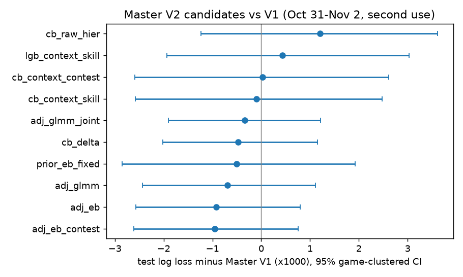

# Master V2 Comparison: player-aware candidates vs Master V1

Run `20261104T221133`. The summary is in
`docs/reports/player_skill/comparison_20261104T221133.json`; the local run directory
`models/experiments/master_v2_runs/` is git-ignored. Reproduce with
`python -m pipeline player-skill compare`.

**Decision: Master V1 stays active** (`configs/serving.yaml`). The best player-aware candidates
improve test log loss by 0.0005–0.0010. That is directionally consistent with the calibration
partition, but every 95% game-clustered CI includes zero. The pre-registered rule was to keep V1
unless V2 genuinely wins.

## Protocol

- **Split.** Master V1's split exactly, asserted in code. All candidates are scored on the same
  tracked shots.
  - model-fit: Oct 20–27, 9,279 shots;
  - calibration: Oct 28–30, 4,019 shots;
  - test: Oct 31–Nov 2, 4,091 shots.
- **No hyperparameter search.** CatBoost candidates reuse V1's tuned `tracking_without_player`
  hyperparameters (depth 5, 746 trees). LightGBM reuses V1's tuned LightGBM. Differences therefore
  come from the player representation only. The `v1_refit` harness check reproduces V1 exactly
  (Δ = 0.00000).
- **Selection on calibration only.** The calibrator, the adjustment coefficients and the selected
  candidate were all chosen on Oct 28–30 with two-fold game-grouped cross-fitting.
- **Test use.** The test partition was scored **once**. This is its **second use**: the first was
  the Master V1 evaluation. No fresh games were available. NBA.com lists no games for Nov 3
  (Election Day), and Nov 4 games had not finished.
- **Player features.** They are computed as of each game date from strictly earlier evidence
  (`master_v2` dataset). NBA xFG is a benchmark only.

## Candidates

| # | Candidate | Description |
| --- | --- | --- |
| 1 | `v1_control` | Master V1 (CatBoost, shot + game context + tracking) |
| 2 | `cb_raw_hier` | CatBoost + raw hierarchical FG priors (+ reliability) |
| 3 | `cb_context_skill` | CatBoost + context-adjusted hierarchical skill, reliability, n_eff |
| 3b | `cb_delta` | CatBoost + one compact feature: the hierarchical logit effect |
| 4 | `cb_context_contest` | 3 + contest features (approaches A, B, D) |
| 5 | `adj_eb` | logit(V1) + a + b·δ_EB: base model + regularized player adjustment |
| 5c | `adj_eb_contest` | 5 + contest deviation + sensitivity terms (approach C) |
| 6 | `adj_glmm` | logit(V1) + a + b·δ_GLMM: hierarchical logistic player effect |
| 6j | `adj_glmm_joint` | 6 with the joint player×contest model (approach D) |
| 7 | `lgb_context_skill` | LightGBM + context-adjusted skill (GBM alternative) |
| – | `prior_eb_fixed` | logit(V1) + δ_EB, nothing fitted on 2026-27 |

## Results

Calibration values are cross-fitted on Oct 28–30. Test is Oct 31–Nov 2 (n = 4,091). Every candidate
selected the "none" calibrator.

| Candidate | Cal log loss | Test log loss | Brier | AUC | ECE (q10) | Cal. slope |
| --- | --- | --- | --- | --- | --- | --- |
| v1_control | 0.60995 | 0.61517 | 0.21420 | 0.6944 | 0.0132 | 0.965 |
| cb_raw_hier | 0.60977 | 0.61638 | 0.21482 | 0.6932 | 0.0184 | 0.951 |
| cb_context_skill | 0.61067 | 0.61506 | 0.21421 | 0.6958 | 0.0192 | 0.973 |
| cb_delta | 0.60940 | 0.61469 | 0.21409 | 0.6968 | 0.0201 | 0.966 |
| cb_context_contest | 0.61082 | 0.61520 | 0.21428 | 0.6960 | 0.0257 | 0.980 |
| lgb_context_skill | 0.61113 | 0.61560 | 0.21448 | 0.6936 | 0.0233 | 0.966 |
| adj_eb | 0.60891 | 0.61424 | 0.21384 | **0.6979** | 0.0186 | 0.971 |
| adj_eb_contest | 0.60893 | **0.61422** | **0.21383** | 0.6978 | 0.0191 | 0.972 |
| adj_glmm | 0.60922 | 0.61447 | 0.21392 | 0.6976 | 0.0207 | 0.967 |
| adj_glmm_joint | 0.60922 | 0.61484 | 0.21404 | 0.6962 | 0.0149 | 0.957 |
| prior_eb_fixed (selected) | **0.60872** | 0.61466 | 0.21405 | 0.6972 | 0.0200 | 0.962 |
| NBA xFG (benchmark) | – | 0.61384 | 0.21382 | 0.6970 | 0.0186 | 0.992 |

Paired differences on test, as candidate minus V1 log loss (×1000). The 95% CIs come from a
game-clustered bootstrap (2,000 resamples, 26 games).

| Candidate | Δ | 95% CI | P(Δ < 0) |
| --- | --- | --- | --- |
| adj_eb_contest | −0.95 | [−2.61, +0.76] | 0.86 |
| adj_eb | −0.93 | [−2.57, +0.80] | 0.85 |
| adj_glmm | −0.70 | [−2.44, +1.11] | 0.78 |
| prior_eb_fixed (selected) | −0.51 | [−2.86, +1.93] | 0.66 |
| cb_delta | −0.47 | [−2.02, +1.16] | 0.72 |
| adj_glmm_joint | −0.34 | [−1.90, +1.22] | 0.67 |
| cb_context_skill | −0.10 | [−2.58, +2.48] | 0.53 |
| cb_context_contest | +0.02 | [−2.59, +2.61] | 0.50 |
| lgb_context_skill | +0.44 | [−1.93, +3.02] | 0.38 |
| cb_raw_hier | +1.20 | [−1.24, +3.61] | 0.17 |

Against NBA xFG, the selected candidate is +0.69 [−6.93, +7.62] and V1 is +1.20 [−6.33, +7.34]. The
gap to NBA narrows, but neither difference is resolvable.

**Subgroups** (test log loss, V1 → adj_eb):

- shooters with history (n = 3,347): 0.6171 → 0.6157;
- shooters without history (n = 744): 0.6064 → 0.6075, slightly worse because the newcomer prior is
  too harsh for second-year players;
- 2PT: 0.5873 → 0.5853;
- 3PT: 0.6482 → 0.6485.

## Interpretation

1. **The integration method matters more than the estimator.** Player skill helps when it enters as
   a single, reliability-weighted logit offset on top of the difficulty model (5, 6, prior). It does
   not help as a bundle of features for a tree trained on 9k shots (2, 3, 4, 7). One compact feature
   (`cb_delta`) beats ten (`cb_context_skill`).
2. **Raw-FG priors are harmful** (+1.2). This replicates V1's failure and confirms that raw ability
   is confounded with shot difficulty.
3. **Fitted coefficients.** The adjustment coefficient fitted on calibration is b = 0.69 for EB and
   0.83 for GLMM. Roughly 20–30% of historical player skill is already captured by V1's tracking
   features.
4. **Contest-specific player terms add nothing** beyond general skill (5c ≈ 5; 6j < 6).
5. **The selection rule chose `prior_eb_fixed`.** It had the best calibration score and is the most
   conservative option because it fits nothing on 2026-27. On test it was not the best player-aware
   candidate, and with this sample size the ordering among the top candidates is noise.

## What would change the decision

- **Fresh games.** About 15.6k test shots (roughly 90 games) are needed to resolve a 0.001 log-loss
  difference. Re-run `player-skill build` and `compare` as games arrive, holding out only games
  played after Nov 4. If `adj_eb` (or `prior_eb_fixed`) keeps a negative Δ whose CI excludes zero,
  promote it as Master V2: V1 plus a fixed hierarchical skill offset, which needs no retraining of
  the tree.
- **Shot-level 2025-26 data,** which would fix the second-year "newcomer" problem.
