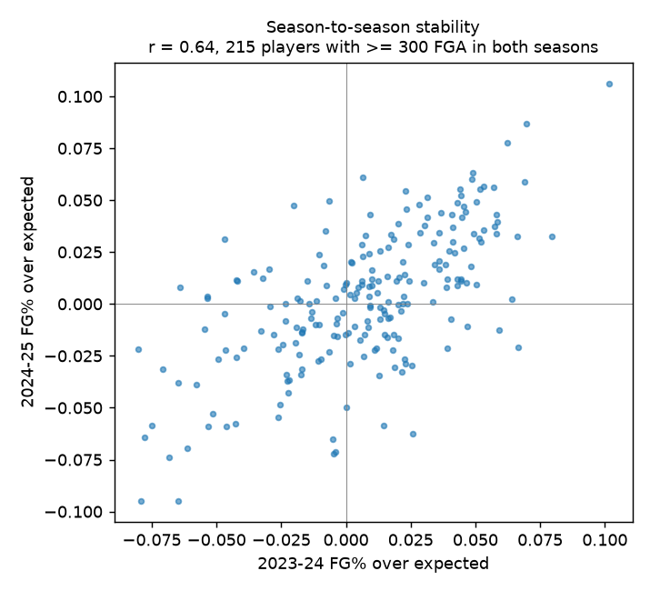
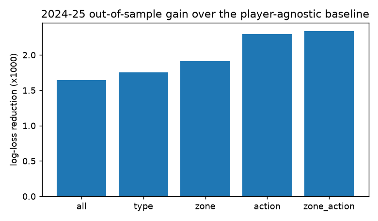

# Player Skill Modelling (Master V2 research track)

Central question: can the model understand both shot difficulty and individual shooting ability well
enough to improve genuine future-shot predictions?

**Short answer.**

- Individual shooting ability is real, stable and measurable.
- A properly built hierarchical skill estimate improves *historical* out-of-sample log loss by
  **0.0023** over a player-agnostic difficulty model (2024-25, 219,527 shots, month-by-month as-of
  scoring).
- On 2026-27 shots, part of that skill is already absorbed by Master V1's tracking features. The
  remaining gain is about 0.0005–0.0009 log loss. That is consistent across calibration and test,
  but well inside the noise of the 4,091-shot test set. Master V1 therefore stays the active model.
  See `MASTER_V2_COMPARISON.md`.

Everything below is reproducible with `python -m pipeline player-skill all`. Code is in
`pipeline/player_skill/`, parameters in `configs/player_skill.yaml`, tables in
`docs/reports/player_skill/` and tests in `tests/test_player_skill.py`.

## 1. What data exists

| Source | Seasons | Granularity | Used for |
| --- | --- | --- | --- |
| ShotChartDetail | 2022-23 (Oct 18 – Jan 6 only, 102,400 shots), 2023-24 (218,700), 2024-25 (219,527) | shot: location, action type, make | difficulty baseline, shot-level skill |
| PlayerDashPtShots, closest defender | 2021-22 … 2025-26 | player × season × 2PT/3PT × defender range (0-2, 2-4, 4-6, 6+ ft) | contest skill; Model A defender priors |
| Official 2026-27 play-by-play | Oct 20 – Nov 2 (107 games, 18,852 FGA) | shot | in-season updating (strictly earlier dates) |
| Blueprint tracking 2026-27 | same games (17,389 matched FGA) | shot: contest distance/height, shot clock, release, speed | Master V1 features; contest mapping |

There are three gaps:

1. **No shot-level 2025-26 data.** `stats.nba.com` timed out from this environment. The most recent
   full season enters only as Dash 2PT/3PT aggregates.
2. **2022-23 is truncated** at Jan 6.
3. **No listed heights or weights.** The public NBA.com players index returned HTTP 403 (access
   denied), and that was not worked around. Blueprint shooter vertical and contest height are the
   only physical proxies.

## 2. Audit of the Model A / Master V1 player features

**How V1's priors are computed** (`pipeline/features/player_priors.py`):

- **Raw FG posteriors.** `fg_post = (made + k·league)/(att + k)` per category (all, 2PT/3PT,
  location group, action family). Uses ShotChartDetail with season weights 0.5/0.75/1.0, and adds
  2025-26 Dash 2PT/3PT counts at the type level.
- **Shot-making over expected.** `smoe_post = Σ(made − xb)/(att + k_smoe)`, shrunk toward 0.
- **Other features.** Shot diet, per-season SD, and Dash FG% in the shot's defender range.
- **Model A** builds similar smoothed tables (`models/legacy/model_a/assets/*.csv`): player,
  location, action, location×action, distance bin and defender range. They can be reused as
  look-ups, but they are raw-FG tables built from 2022-24 only.

**Why the 20 V1 player features did not help** (V1 test: +0.0030 log loss when added). The causes are
listed in order of evidence.

| Cause | Evidence |
| --- | --- |
| **Representation and integration** (main cause) | Each over-expected prior adds signal on its own. As a single offset term on top of the V1 tracking model, `pl_smoe_family_post` improves cross-fitted calibration log loss by 0.0012, and `pl_smoe_type_post` by 0.0010 (`feature_signal_calibration.csv`). CatBoost given all 20 correlated raw features on 9,279 training shots learns noise instead. Ten feature pairs have \|r\| > 0.8. |
| **Raw FG confounded with difficulty** | Raw FG posteriors correlate 0.51–0.76 with the base model's logit (a rim-heavy player has a high raw FG%) and add nothing (+0.0000 to +0.0008). The skill signal is in the difficulty-adjusted residual, not in raw ability. |
| **Contest priors on mismatched scales** | V1 mapped Blueprint `contest_distance_in` to Dash ranges with the nominal foot thresholds. The distributions do not match: 61% of Blueprint 3PA fall under 4 ft, against 9% in Dash (Section 5). `pl_fg_def_range_*` therefore looked up the wrong cells. |
| **In-sample residuals** | The difficulty baseline was fitted and scored on the same 540,627 shots. Its in-sample log loss is 0.6349 against 0.6366 out-of-fold. The effect on skill variance is small (τ 0.0306 vs 0.0307), but it is now removed. |
| **Untuned shrinkage** | k values were hand-set: 150–250 for both raw FG and over-expected. Tuned on chronological validation, the over-expected k is 450 at the general level, 300 at the action level and 2,500–8,000 at finer levels. V1's finer-level estimates were therefore far too noisy. |
| **Zero and median filling** | Players without history got `smoe = 0` and the league-median season SD. True newcomers shoot 4.0 points below expectation (2024-25: −0.0398 vs +0.0029 for veterans). |
| **Coverage** | 14.6% of tracked 2026-27 shots come from 99 players with no 2022-25 shot history. Half of those shots come from players with only 2025-26 Dash aggregates (for example, last season's rookie class). At the location×action level, 65% of shots have fewer than 200 historical attempts in the node. |
| **Sample size** | The theoretical gain from *perfect* knowledge of general skill is 0.0023 (τ = 0.031 at mean p(1−p) = 0.22). The realistic gain at the 2026-27 reliability of the estimates is 0.0014. This is below the ~0.006 half-width of the test CI. |
| **Recency** | Mostly not a cause. Validation prefers long half-lives (best 1,460 days; 365 days is 0.00007 worse). |

## 3. Is player skill real? Variance and stability

Between-player SD of the true rate (method of moments, removing binomial noise, players with ≥ 50
attempts; `skill_variance.csv`):

| Level | Raw FG τ | Over-expected τ |
| --- | --- | --- |
| all shots | 0.056 | **0.031** |
| 2PT / 3PT | 0.052 / 0.027 | 0.038 / 0.027 |
| rim / paint / short mid / long mid | 0.052 / 0.052 / 0.038 / 0.034 | 0.044 / 0.047 / 0.036 / 0.032 |
| corner 3 / above-the-break 3 | 0.031 / 0.026 | 0.030 / 0.025 |
| 3PT catch-and-shoot / pull-up / step-back | 0.029 / 0.024 / 0.020 | 0.029 / 0.022 / 0.018 |

Raw-FG spread is almost twice the over-expected spread at the general level. Half of the apparent
"ability" is shot diet.

Season-to-season correlation of over-expected rate (`season_reliability.csv`):

- **All shots:** 0.64–0.66 (players with ≥ 300 FGA in both seasons).
- **2PT:** 0.66.
- **3PT:** 0.32–0.41.
- **Rim:** 0.66–0.82.

Three-point skill is real but needs a large sample.

## 4. Hierarchical, context-adjusted skill

**Taxonomy** (`pipeline/player_skill/taxonomy.py`):

- **L1 general:** all shots; 2PT and 3PT.
- **L2 location:** rim, paint, short mid (< 16 ft), long mid, corner 3, above-the-break 3.
- **L3 action:** type × action family (catch-and-shoot jumper, pull-up, step-back, floater, hook,
  layup, dunk, tip, …).
- **L4 location × action:** its parent is location + action − type.
- **L5 contest:** type × closest-defender range (Section 5).

**Estimator** (`pipeline/player_skill/hierarchy.py`). Empirical Bayes, top-down. For each node:

\[ \theta_{node} = \theta_{parent} + \frac{n_{eff}}{n_{eff}+k_{level}}\,(\bar r_{node} - \theta_{parent}),\qquad n_{eff} = \frac{(\sum w)^2}{\sum w^2} \]

How the pieces are defined:

- **Residuals.** \(r = made - xb_{OOF}\), where \(xb_{OOF}\) comes from a leave-one-season-out
  difficulty baseline built from location, action and game time. It uses no player identity and is
  never NBA xFG.
- **Weights.** \(w = 0.5^{age/half\_life}\).
- **Root prior.** The veteran or newcomer mean, not zero.
- **Fallback.** A node without evidence inherits its parent's estimate.
- **Logit-scale effect.** \(\delta = \theta / \overline{p(1-p)}_{node}\).
- **Outputs per shot.** θ, reliability, n_eff and attempts at every level (`ps_*` columns of
  `master_v2`). Raw-FG hierarchical posteriors are computed alongside for comparison.

**Chronological tuning** (`pipeline/player_skill/tuning.py`, `docs/reports/player_skill/tuning.json`).
2024-25 shots are scored month by month, using only evidence before each month.

| Configuration | Validation Δ log loss vs baseline |
| --- | --- |
| general level only | −0.00164 |
| + 2PT/3PT | −0.00176 |
| + location | −0.00191 |
| + action | −0.00230 |
| + location × action (final) | **−0.00234** |

Other tuning results:

- **Tuned k:** all 450, type 4,000, location 2,500, action 300, location×action 8,000.
- **Half-life:** 1,460 days. Differences across 365 days, 730 days and no decay are below 0.0001.
- **Newcomer and veteran root means:** improve validation by 0.00015 over zero.
- **Dash aggregates for the gap season:** in the production analog (shots end one season early,
  last season known only via Dash), Dash weight 0 is best. The loss is 0.0019 at weight 0 versus
  0.0016 at weight 1. The Dash residual is contest-adjusted but not location-adjusted, so it is
  confounded with shot diet.

**Penalized hierarchical logistic model** (`pipeline/player_skill/glmm.py`). This is the posterior
mode of nested player, player×type, player×location, player×action and player×location×action
effects, with offset logit(xb_OOF). Validation gain is −0.00223 at the default penalties. Penalty
multipliers of 0.5, 2 and 4 give −0.00214, −0.00210 and −0.00181. It matches the EB estimator, and
the two agree closely (r = 0.91 on 2026-27 shots).

## 5. Contest-specific ability

**Compatibility audit** (`contest_compat_nominal.csv`, `contest_compat_mapped.csv`). With the
nominal foot thresholds, Blueprint and Dash do not describe the same quantity.

| 3PA share | tight < 2 ft | close 2-4 | open 4-6 | wide 6+ |
| --- | --- | --- | --- | --- |
| Dash 2025-26 | 0.3% | 9.0% | 38.4% | 52.3% |
| Blueprint 2026-27 | 18.1% | 42.7% | 19.0% | 20.2% |

**Quantile mapping.** I re-derived Blueprint inch thresholds that reproduce the Dash shares, using
contest distances of model-fit games only and no outcomes:

- **2PT:** 14.0 / 49.2 / 89.6 in.
- **3PT:** 9.9 / 19.8 / 38.8 in.

After mapping, 3PT FG% per range matches Dash: close 29.7% vs 30.3%, open 34.1% vs 33.8%, wide 37.5%
vs 38.5%. On 2PT the gradient is far steeper in Blueprint (tight 27.5% vs 46.6%, wide 80.5% vs
66.1%). Blueprint measures the contest at release and is much more informative, so Dash 2PT contest
splits are only loosely comparable.

**Approaches** (`pipeline/player_skill/contest.py`):

- **A, contest-category prior.** The player's FG in the (type, range) cell relative to his own
  type-level FG, shrunk.
- **B, contest sensitivity.** The player's open-minus-tight gap relative to the league gap, shrunk.
- **C, base plus regularized adjustment.** A and B added to the player-skill offset.
- **D, joint hierarchical model.** Dash binomial rows with player×type×range effects, plus in-season
  tracked shots.

**Results:**

- **History.** On next-season Dash cells, A and B reduce binomial log loss by only 0.00017–0.00033
  per attempt (best k ≈ 100–400).
- **2026-27 calibration partition.** None adds signal beyond the player-skill effect. A alone is
  harmful (+0.0008 cross-fitted); B and the joint contest effect are about 0.
- **Test.** C equals the skill-only adjustment (−0.00095 vs −0.00093), and D is weaker (−0.00034).
- **Conclusion.** Contest-specific player ability is not detectable with current data. Shot-level
  contest distance is already a Master V1 feature.

## 6. Physical attributes and archetypes

**Heights and weights.** No licensed source was reachable: the NBA.com players index returned 403.
The shooter release-vertical proxy (as-of mean of Blueprint `shot_vertical_in` on jumpers) has no
usable signal on top of V1: it is +0.0027 worse, cross-fitted. Defender length is already in V1 via
shot-level `contest_height_in`.

**Archetypes.** k-means on shrunk historical shot-diet shares (outcome-free) finds 6 clusters. The
silhouette score is 0.20, meaning weak structure (`archetypes.csv`). The groups are rim bigs,
perimeter creators, spot-up shooters, slashers, mid-range creators and interior finishers. Mean
over-expected by archetype ranges from −0.023 to +0.022, a between-archetype SD of 0.015. That is
half of the between-player SD, and the archetype code adds no signal (0.00001). Archetypes describe
style rather than make-skill, so they are kept as a descriptive feature (`ps_archetype`) only.

## 7. Player diagnostics

Players were chosen by rules fixed before seeing results (`pipeline/player_skill/report.py`):

- **Named players:** Luka Dončić, Shai Gilgeous-Alexander and Stephen Curry.
- **Catch-and-shoot specialists:** ≥ 300 3PA, ≥ 85% catch-and-shoot, and threes ≥ 60% of FGA.
- **Rim finishers:** rim share ≥ 55%.
- **Guards:** box-score "G" (starters only; no heights, so no "small" filter).
- **Limited history:** < 200 historical FGA.

For each group the table shows the 5 players with the most attempts plus the aggregate over all
members. The evaluation shots are the calibration partition (cross-fitted) plus the test partition.
V2 means `adj_eb`, i.e. V1 + hierarchical skill adjustment. Full table:
`docs/reports/player_skill/player_diagnostics.csv`.

| Player / group | Hist FGA | Hist FG | Hist xFG | Resid | θ_all (n_eff, rel) | Eval FGA | Actual | V1 | V2 | NBA xFG | LL V1 → V2 |
| --- | --- | --- | --- | --- | --- | --- | --- | --- | --- | --- | --- |
| Stephen Curry | 3,227 | .457 | .401 | +.057 | +.049 (3,239, .88) | 70 | .443 | .377 | .413 | .361 | .645 → .634 |
| Shai Gilgeous-Alexander | 3,843 | .521 | .476 | +.046 | +.042 (3,873, .90) | 69 | .420 | .467 | .496 | .429 | .680 → .690 |
| Luka Dončić | 3,497 | .479 | .423 | +.056 | +.051 (3,534, .89) | 69 | .536 | .396 | .435 | .383 | .710 → .695 |
| Grayson Allen (C&S) | 1,441 | .468 | .430 | +.038 | +.033 (1,467, .77) | 36 | .444 | .388 | .426 | .382 | .705 → .691 |
| Trey Lyles (C&S) | 847 | .430 | .443 | −.013 | −.005 (852, .65) | 21 | .524 | .451 | .448 | .455 | .601 → .601 |
| Giannis Antetokounmpo (rim) | 3,385 | .591 | .592 | −.001 | +.002 (3,410, .88) | 49 | .673 | .611 | .619 | .608 | .480 → .468 |
| Amen Thompson (rim) | 1,143 | .549 | .570 | −.021 | −.017 (1,208, .73) | 46 | .500 | .630 | .625 | .650 | .461 → .455 |
| Tyrese Maxey (guard) | 2,834 | .445 | .455 | −.010 | −.007 (2,909, .87) | 71 | .549 | .448 | .442 | .428 | .629 → .626 |
| Cooper Flagg (limited) | 0 | – | – | – | −.015 (88, .16) | 60 | .417 | .470 | .462 | .465 | .599 → .600 |
| Darius Acuff Jr. (limited) | 0 | – | – | – | −.038 (144, .24) | 67 | .493 | .443 | .413 | .420 | .657 → .667 |
| **All named (3)** | | | | | | 208 | .466 | .413 | .448 | | .678 → .673 |
| **All catch-and-shoot (12)** | | | | | | 172 | .413 | .404 | .417 | | .643 → .637 |
| **All rim finishers (30)** | | | | | | 598 | .589 | .601 | .601 | | .566 → .561 |
| **All guards (66)** | | | | | | 2,284 | .452 | .442 | .446 | | .627 → .625 |
| **All limited-history (120)** | | | | | | 1,628 | .466 | .477 | .458 | | .601 → .601 |

**Elite shot-makers.** V1, like NBA xFG, systematically under-predicts elite shot-makers. Curry and
Luka have +0.05 to +0.06 historical residuals with reliability near 0.9. V1 predicts 37.7% and
39.6%, NBA xFG predicts 36.1% and 38.3%, and they shoot 44.3% and 53.6%. V2 moves both toward the
truth. SGA moves the wrong way on 69 shots, which is the expected noise at this sample size.

**Group aggregates.** Every group improves or ties. The limited-history group ties: the newcomer
prior lowers predictions by 1.9 points on average (actual .466 vs V1 .477 vs V2 .458).

**Structural problem.** Cooper Flagg is a second-year player but is treated as a newcomer, because
2025-26 shot-level data is missing. The rookie prior (−0.040) is probably too harsh for such players.

## 8. Conclusions and next steps

1. Skill exists: 3.1-point SD over expected, season-to-season r ≈ 0.65. It is best represented as a
   **single hierarchical, difficulty-adjusted logit offset with explicit reliability**, not as many
   raw features handed to a tree on 9k shots.
2. The historical, temporally validated gain (0.0023) shrinks to about 0.0005–0.0009 on top of
   tracking. Tracking features (contest distance, shot clock) partly encode who is shooting, because
   defenders guard good shooters closer.
3. **Highest-value data improvement:** shot-level 2025-26 ShotChartDetail. It would fix the
   second-year "newcomer" problem and recency. Second priority: a licensed roster file (heights,
   positions, draft year) to separate true rookies from returning players.
4. Re-evaluate on fresh games: about 15.6k test shots are needed to detect a 0.001 log-loss
   improvement. The pipeline (`player-skill build` → `compare`) is ready to re-run as games arrive.
